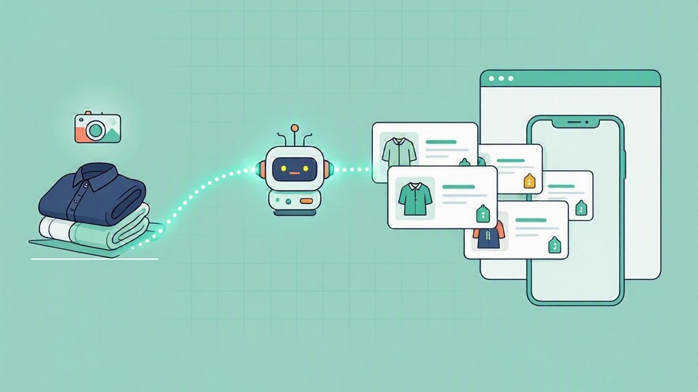

# Vinted Auto-Lister



Drop product photos into a folder and let an AI coding agent (e.g. GitHub Copilot)
analyse them, research prices, and create **draft** listings on Vinted for you —
then move the processed photos aside and log every listing in `LISTINGS.md`.

> **Unofficial.** Vinted has no public API. This project talks to Vinted's private
> web endpoints using your own logged-in session. Automating listings may violate
> Vinted's Terms of Service and can get your account rate-limited or suspended.
> Use at your own risk, keep volumes human, and default to drafts.

## Quick start

```bash
git clone <this-repo> && cd vinted
python3 -m venv .venv && .venv/bin/pip install -e .
cp .env.example .env
.venv/bin/vinted auth import   # paste a DevTools "Copy as cURL" to fill tokens
# drop product photos into inbox/, then ask your AI agent:
#   "process my inbox and create Vinted drafts"
```

The full workflow the agent follows is encoded in
[.skills/vinted-lister/SKILL.md](.skills/vinted-lister/SKILL.md) — grouping photos
per product, identifying brand/size/colour/condition, resolving IDs, pricing, and
creating drafts. Your personal photos, `.env`, and `LISTINGS.md` are gitignored,
so nothing personal is ever committed.

## How it works

1. **You** dump raw product photos into `inbox/` (HEIC or JPG; a few shots per item).
2. **The agent** looks at the photos, groups them per product, reads brand / size /
   colour / condition off the label, and picks the right Vinted category.
3. It asks Vinted for an image-based **price suggestion** and applies your price rules.
4. It uploads the photos and creates a **draft** listing via the Python client in `vinted/`.
5. It moves that product's photos into `posted/NN-slug/` and appends a row to `LISTINGS.md`.
6. Anything it is unsure about goes to `review/` for you to check.

The Python client (`vinted/`) handles auth and the API calls. The *vision* step —
identifying what each photo shows — is done by the agent, so you drive it from chat:
just say e.g. *"process the next 5 products in inbox, listings in English."*

## Setup

```bash
python3 -m venv .venv
.venv/bin/pip install -e .       # installs deps + the `vinted` CLI
cp .env.example .env
.venv/bin/vinted auth import      # paste a DevTools "Copy as cURL" to fill tokens
```

### Getting your tokens (one-time)

The easiest way is `vinted auth import`: log in to Vinted in your browser, open
DevTools → **Network**, right-click any `https://www.vinted.<cc>/api/v2/...`
request → **Copy → Copy as cURL**, run `vinted auth import` and paste it. It pulls
the cookies (`access_token_web`, `refresh_token_web`, `_vinted_fr_session`,
`datadome`, `anon_id`) and headers (`x-csrf-token`, `x-anon-id`) into `.env`.

Tokens are short-lived; re-run `vinted auth import` if you start getting `401`/`403`.

## Usage

The agent drives the `vinted` CLI under the hood — you can use it manually too:

```bash
vinted whoami
vinted brands "ralph lauren"
vinted catalogs skjorta
vinted draft --photo inbox/IMG_0001.jpg --photo inbox/IMG_0002.jpg \
  --title "Ralph Lauren oxford L" --category "enfärgade skjortor" \
  --brand "Ralph Lauren" --size L --condition very_good --color White

# Manage your existing live ads (read from the account, not a local file):
vinted ads                         # list your live listings
vinted item 9226208711             # show one ad (id or full URL)

# Edit one or many fields in a single call (only the fields you pass change;
# photos are preserved):
vinted edit 9226208711 \
  --price 300 \
  --description "new, more sales-y text" \
  --category "enfärgade skjortor"

vinted reprice --brand "Ralph Lauren" --from 350 --to 300 --dry-run
```

The agent works in **any language** — tell it which language to write titles and
descriptions in.

### Categories, brands, colours & sizes are resolved live

You never hardcode IDs. `--category`, `--brand`, `--size`, `--color` accept plain
keywords and are looked up against Vinted's **live** API at call time
(`item_upload/catalogs/search`, `/brands`, `/colors`, `/size_groups`), so new or
renamed categories just work. Vinted catalog **IDs are numeric and global** — the
same across markets — so you can always pass an ID directly.

The files in `data/` (`catalog_lookup_<domain>.json`) are only a **display cache**
that labels an ID with its human path (e.g. `Herr > Skjortor > Enfärgade`); they are
not the source of truth. To refresh them or build a cache for another market
(e.g. English `vinted.co.uk`), set `VINTED_DOMAIN` in `.env` and run:

```bash
python tools/fetch_catalogs.py   # writes data/catalog_lookup_<domain>.json
```

```
inbox/    you dump raw product photos here (unsorted)
posted/   processed products (one subfolder per item) after a draft is created
review/   products the agent was unsure about — you check and move to inbox/
vinted/   the Python client (auth, upload_photo, pricing, create/update draft)
data/     cached reference data (catalog tree, etc.)
tools/    one-off and helper scripts
LISTINGS.md  log of every draft created
```

## Pricing

Brand rules live in `vinted/pricing.py` (`BRAND_PRICE`). Brands without a rule
fall back to Vinted's **premium** price suggestion. Edit the map to your own prices.

## Security

- `.env` and all tokens are gitignored. Never commit credentials.
- Type secrets directly into `.env`; don't paste them into chat.
- Rotate tokens by logging out/in on Vinted if they are ever exposed.
